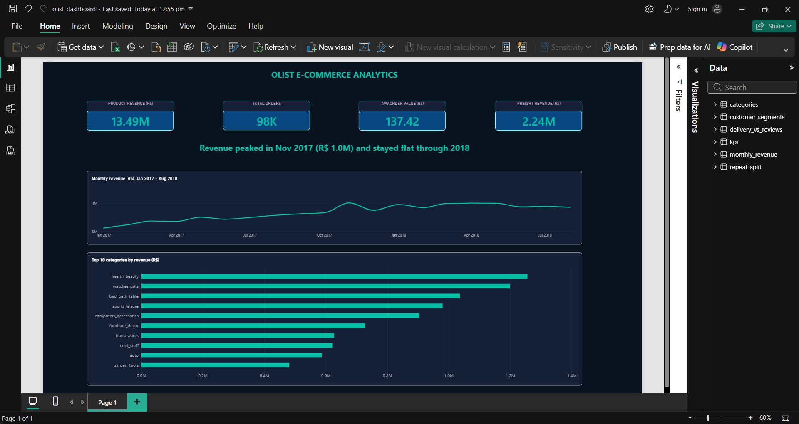

\# Olist E-commerce Revenue \& Customer Analytics

\*\*Business question:\*\* Where does revenue come from, which customers come back, and how much does late delivery hurt customer reviews?

\*\*Tools:\*\* MySQL (SQL, window functions, CTEs), Python (pandas, SciPy, matplotlib), Power BI, Git

\*\*Data:\*\* \[Olist Brazilian E-commerce dataset (Kaggle)](https://www.kaggle.com/datasets/olistbr/brazilian-ecommerce), 9 tables, about 100K orders from 2016 to 2018 (CC BY-NC-SA 4.0). All money is in Brazilian reais (R$).

\## Key findings

\- \*\*Revenue:\*\* 98,199 valid orders brought in R$ 13.49M of product revenue (average order R$ 137.42). Revenue peaked in Nov 2017 (R$ 1.0M, +52% vs October) and stayed flat through 2018, between about R$ 840K and R$ 990K a month.

\- \*\*Growth came from volume:\*\* average order value stayed in a narrow band (about R$ 125 to R$ 150), so more orders, not bigger orders, drove growth. Year-over-year growth fell from +687% (Jan 2018, small base) to +49% (Aug 2018).

\- \*\*Categories:\*\* health\_beauty leads (9.3% of revenue), then watches\_gifts (8.9%) and bed\_bath\_table (7.7%). 18 of 74 category labels bring in 80% of revenue.

\- \*\*Retention is the weak spot:\*\* of 94,983 customers, only 2,887 (3.04%) bought more than once. Repeat customers bring 5.6% of revenue.

\- \*\*Customer value depends on spend:\*\* the higher-spend half of one-time buyers is about 47.5% of customers but 78% of revenue. The biggest win-back group is 22,436 higher-spend customers whose last purchase was before 22 Jan 2018, holding 39% of revenue.

\- \*\*Late delivery and reviews:\*\* across 95,824 delivered orders with a review, the average score is 4.29 for on-time orders, 2.72 for 1-7 days late and 1.70 for 8+ days late. 79% of the 8+ days late orders got 1-2 stars. A Mann-Whitney U test gives p < 0.001, and an on-time order scores higher than a late one in about 82% of random pairs.

\## Method and decisions

\- Canceled and unavailable orders are excluded from revenue. Raw data is never changed; filters are applied in queries and in the `vw\_order\_revenue` view.

\- Each table is aggregated to one row per order before joining, so rows do not multiply and revenue is not double counted.

\- Customer analysis uses `customer\_unique\_id` (the real person). `customer\_id` is created per order, so it cannot count repeat buyers.

\- Analysis window for trends is 2017-01 to 2018-08; 2016 months (1 to 290 orders) and 2018-09 (1 order) are too small for growth rates.

\## Data quality checks

\- 14 orders have a status that disagrees with the delivery date (8 delivered without a date, 6 canceled with one). Kept in raw data, excluded where relevant.

\- Item totals match payment totals for 98,362 of 98,665 orders (99.7%).

\- 775 orders have no items (mostly unavailable and canceled). Items with no category are 1.3% of revenue and are kept visible as "unknown".

\## Limitations

\- Late delivery is linked to lower reviews; this does not prove it is the only cause, and only customers who left a review are included.

\- RFM groups use quartiles, so their near-equal sizes come from the method. "Lapsed" means an older last purchase, not proven churn.

\## Repository

\- `sql/01\_setup`: create tables and load the CSVs

\- `sql/02\_cleaning`: profiling and cross-checks

\- `sql/03\_analysis`: view, trends, categories, customers, delivery

\- `python`: hypothesis test and chart, plus the export script for the dashboard

\- `dashboard`: Power BI report

\- `docs`: charts and the daily progress log

\## How to reproduce

1\. Download the dataset and load it with the scripts in `sql/01\_setup`.

2\. Run the files in `sql/02\_cleaning` and `sql/03\_analysis` in order.

3\. Run `python python/02\_export\_for\_powerbi.py` to regenerate the dashboard tables, then open `dashboard/olist\_dashboard.pbix`.

